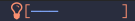
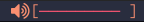

#+TITLE: slothbar
#+OPTIONS: toc:nil ^:{}

Slothbar is a window manager status bar that runs within Emacs.

It is window manager agnostic, written completely in elisp, and fully
configurable in Emacs.

It has been tested with [[https://github.com/emacs-exwm/exwm][Exwm]], [[https://xmonad.org][xmonad]], [[https://herbstluftwm.org][herbstluftwm]], [[https://github.com/conformal/spectrwm][spectrwm]], [[https://stumpwm.github.io/][stumpwm]],
and [[https://i3wm.org/][i3]] on Xorg, and with [[https://swaywm.org][sway]] on Wayland.

It is currently pre version 1.0 and the API is not yet stable.

On Xorg, slothbar uses xcb via xelb.  On Wayland it uses [[../elwl][elwl]] and the
wlr-layer-shell protocol.  Both backends use fontsloth for glyph rasterization.

Current version: *0.31.0* [[https://melpa.org/#/slothbar][file:https://melpa.org/packages/slothbar-badge.svg]]
See [[./CHANGELOG.org][CHANGELOG.org]] for notable changes.
#+BEGIN_export html

#+END_export

The melpa version only supplies the dependencies needed to work on
Xorg. If you are on Wayland, you'll need to install [[https://git.gay/agnes-li/elwl][elwl]]. Wayland
support is still early stages.

Note: *At present this requires Emacs 28.0*
If you would like it to work on Emacs 27, please let me know.

* Usage

To start slothbar, run =M-x slothbar-mode=. On first run, expect a
font-loading delay before the bar appears. With byte-compiled fontsloth
and one of the preferred nerd-bundle fonts available, an isolated
cold-cache load measured about 0.4 seconds in one test environment.
Interpreted fontsloth, or multiple very large fonts, can take several
seconds. Fonts configured in =slothbar-font-candidates= are cached for
later runs.

At first there is an empty bar without any modules. The background
color will match the current Emacs background color.

** Display backend

=slothbar-backend= selects the display backend:

- =auto= (default) uses Wayland when =WAYLAND_DISPLAY= names an existing
  socket and elwl is loadable; otherwise it uses =xcb=.
- =xcb= forces the X11 backend.
- =wayland= forces the wlr-layer-shell backend.

The Wayland backend is an independent Wayland client, so Emacs may itself be
running under XWayland or a pgtk/Wayland frame.  It requires [[../elwl][elwl]] and the
=fd-fairy= dynamic module on =load-path=.  X-only modules such as the system
tray are skipped automatically.  On Wayland the workspaces module uses the
compositor's ext-workspace protocol when it is advertised, and is skipped
otherwise, =slothbar-randr-mode= and =slothbar-ewmh-mode= report that they are
unsupported and disable themselves.

** Displaying modules

The customizable variable =slothbar-modules= is a list of either
functions that return modules or one or more of the layout
instructions =:left=, =:right=, and =:center=. A module must satisfy the
predicate =slothbar-module-p=.

The following displays all the built-in modules with default settings:

#+begin_src emacs-lisp
  (require 'slothbar-module-requires)

  ;;; layout tray, date, workspaces, and sysinfo to the left, and wifi,
  ;;; volume, backlight, and battery to the right
  (setq slothbar-modules
        '(:left
          slothbar-tray-create slothbar-date-create
          slothbar-workspaces-create slothbar-sysinfo-create
          slothbar-focus-create
          :right
          slothbar-wifi-create slothbar-volume-create
          slothbar-backlight-create slothbar-battery-create))
#+end_src

Eval the code above with slothbar running to see the results soon after.

Customizing slothbar-modules will automatically require
slothbar-module-requires.

Multiple instances of the same module may coexist. The following adds
an additional volume module to control microphone volume:

#+BEGIN_SRC emacs-lisp
  (setq slothbar-modules
        '(:left
          slothbar-tray-create slothbar-date-create
          slothbar-workspaces-create
          :right
          slothbar-wifi-create slothbar-volume-create
          (lambda ()
            (slothbar-volume-create :icon '((1 . ?󰍭) (110 . ?󰍬))
                                    :channel "Capture"
                                    :format "^8^f2^[^f4%i^]%p"))
          slothbar-backlight-create slothbar-battery-create))
#+END_SRC

** Multiple bars

`slothbar-bars` defines one or more bars.  When it is non-nil it is
authoritative: exactly one bar is created per entry and matching output.
When it is nil, a non-nil `slothbar-modules` still creates one legacy
default bar.  When both are nil, slothbar creates no bars.

#+begin_src emacs-lisp
  (setq slothbar-bars
        '((:id main
           :output :each
           :modules (:left slothbar-date-create
                           slothbar-workspaces-create
                           :right slothbar-battery-create))
          (:id secondary
           :output "HDMI-A-1"
           :height 20
           :offset-y 24
           :modules (:left slothbar-focus-create))))
#+end_src

Each entry is a plist.  `:id` distinguishes entries, and `:output`
selects where the bar appears:

- `nil` or omitted: one bar on `slothbar-preferred-display`, falling
  back to the first connected output.
- a string: one bar while that output exists.
- a list of strings: one bar for each listed output that exists.
- `:each`: one bar for every connected output.

Multiple entries may use `:output :each` to put more than one bar on
each output.  Bars are created, removed, and recreated as outputs are
connected and disconnected, and changing `slothbar-bars` while slothbar
is running reconciles the bar list.  Bars with an `:id` are updated in
place; bars without one are matched by config index and output.

`:modules` accepts the same list as `slothbar-modules`.  When omitted,
the bar inherits `slothbar-modules`; an explicit `:modules nil` creates
an empty bar.  `:height`, `:width`, `:offset-x`, `:offset-y`, and
`:bottom` override the corresponding global settings for that bar.

The XEmbed tray is single-instance.  If it is included in more than one
bar, the first configured bar keeps it and later instances are skipped.

** Workspaces

The workspaces module reads EWMH workspace properties on X11, EXWM workspace
state under EXWM, and ext-workspace-v1 on Wayland when the compositor
advertises =ext_workspace_manager_v1=.  ext-workspace reports whether a
workspace is active and urgent, but not whether it contains windows, so
inactive workspaces use the =:inactive= status.  Hidden workspaces are
omitted, and workspaces are ordered by their ext-workspace coordinates when
available.

Implementations of =slothbar-workspaces-generate-list-fn= can return the
statuses =:window=, =:current=, =:blankish=, =:inactive=, and =:urgent=;
=:current= may be combined with =:urgent=.

Left-clicking a workspace label switches to that workspace when the active
source can activate workspaces: ext-workspace on Wayland, EWMH on X11, or
EXWM directly.  Hovering a workspace label brightens it; modules can implement
`slothbar-module-hover' to provide their own hover feedback.

** Focused window

The focus module shows the title and, optionally, the application id of the
currently focused window.  It uses the active EWMH window on X11 and the wlr
foreign-toplevel protocol on Wayland.

#+begin_src emacs-lisp
  (setq slothbar-modules '(:left slothbar-focus-create))
  (setq slothbar-focus-format "%a: %t")
#+end_src

=%t= is the window title and =%a= is the application id.  The default format
is =%t=.  Titles are truncated according to
=slothbar-focus-truncate-to-width=, and =slothbar-focus-refresh-interval=
controls polling where the backend has no focus-change notification.  Window
icons are not included yet.

** System information

The sysinfo module gathers CPU, memory, swap, disk, network, load, uptime,
process, thermal, battery, and system identity fields.  The Linux providers
read =/proc= and =/sys=; unavailable values are shown as
=slothbar-sysinfo-missing=.

Its display is configured with a token list, compiled by
=slothbar-format-compile=:

#+begin_src emacs-lisp
  (setq slothbar-sysinfo-format
        '((:cpu-usage :width 3 :suffix "%")
          " "
          (:memory-usage :width 3 :suffix "%")
          " "
          (:temperature)))
#+end_src

Tokens can use =:width=, =:precision=, =:pad=, =:truncate=, =:case=,
=:prefix=, =:suffix=, =:char=, and =:decimals=.  =:decimals= rounds the
number before formatting, and =:width= applies to the resulting value
string.  The width counts the sign, decimal point, and digits of that value,
but not =:prefix= or =:suffix=.  For example, a value formatted as =7.2=
with =( :cpu-usage :width 4 :decimals 1 )= becomes = 7.2=; with
=:pad :zero= and width 5 it becomes =007.2=; =12.3= already fills width 4.
Width alone is a minimum and does not truncate.  =:precision= truncates the
formatted string and can remove decimal digits; use =:decimals= for rounding.

The available field keywords are in =slothbar-sysinfo-fields=; common ones
include =:cpu-usage=, =:memory-usage=, =:disk-usage=, =:net-down=, =:net-up=,
=:load-1=, =:uptime=, =:process-count=, =:temperature=, and
=:battery-percent=.

=slothbar-sysinfo-refresh-interval= controls how often the module updates its
status, while =slothbar-sysinfo-intervals= controls how often each provider
category is read.  The default format shows CPU and memory percentages with their icons to the right.

** Fun or tiresome things to configure

+ =slothbar-height= the desired height in pixels
+ =slothbar-font-candidates= a list of lists where each inner element is
  a font name, highest preference first, and each outer element
  corresponds to format color codes =^f0=-=^f9=
+ =slothbar-is-bottom= set to =t= to position the bar on the bottom of the
  display
+ =slothbar-margin-y= margin in pixels for the gap between bar and struts
+ =slothbar-preferred-display= the name of the preferred display or nil
  to use the primary display
+ ~(slothbar-randr-mode)~ to enable multi-screen support

Modifications to height and font-candidates will reflect automatically
while slothbar is running.

Modifications to is-bottom, margin-y, and preferred-display take
effect with =M-x slothbar-refresh=.

** Diagnostics

=M-x slothbar-debug-info= opens =*slothbar-debug-info*= with the current
backend, output, bar, surface, module, provider, and timer state. It is
useful when reporting output hotplug, visibility, or module lifecycle
problems.

** Helpful integration

If =C-h v= is provided by [[https://github.com/Wilfred/helpful][Helpful]], Helpful's value display uses
=pp-to-string= and bypasses slothbar's compact =cl-print-object= methods.
Enable the optional advice to make slothbar bars, modules, backends, and
colors print compactly:

#+begin_src emacs-lisp
  (slothbar-install-helpful-pp-advice)
#+end_src

Disable it with:

#+begin_src emacs-lisp
  (slothbar-remove-helpful-pp-advice)
#+end_src

The advice only changes values containing slothbar structures. Ordinary
values continue through Helpful's normal formatter.

Slothbar objects print with line breaks and indentation by default. Set
=slothbar-print-multiline= to =nil= for compact single-line values in logs
and backtraces.

** Minimal use-package

#+begin_src emacs-lisp
  (use-package slothbar
    :config
    (require 'slothbar-module-requires)
    (setq slothbar-modules '(:left slothbar-tray-create slothbar-date-create
                             slothbar-workspaces-create
                             :right slothbar-wifi-create slothbar-volume-create
                             slothbar-backlight-create slothbar-battery-create))
    ;; to enable multi-screen support
    (slothbar-randr-mode))

  ;;; then M-x: slothbar
  ;;; To exit:
  ;;; M-x: slothbar-exit
#+end_src

* Installation

Ensure that *xauth* is installed.

Install using [[https://github.com/quelpa/quelpa][quelpa]], [[https://github.com/radian-software/straight.el][straight.el]], or your favorite direct-from-source
package manager.

See the [[./slothbar.el][./slothbar.el]] Package-Requires header for a list of package
dependencies. All dependencies are available from either elpa or
melpa.

** Fonts
Check the default value of =slothbar-font-candidates= in
[[./slothbar-font.el][./slothbar-font.el]] to determine a minimal set of fonts.

E.g. if =slothbar-font-candidates= is:
#+BEGIN_SRC emacs-lisp
  '(("Aporetic Sans" "IBM Plex Serif" "Deja Vu Serif" "Cantarell")
    ("Font Awesome")
    ("Aporetic Sans Mono" "IBM Plex Mono" "DejaVu Sans Mono:style=Book")
    ("all-the-icons")
    ("Symbols Nerd Font Mono"))
#+END_SRC
then for module format strings using:
+ =^f0= ensure one of Aporetic Sans, IBM Plex Serif, Deja Vu Serif, or
  Cantarell is installed
+ =^f1= install the free version of font awesome
+ =^f2= ensure one of Aporetic Sans Mono, IBM Plex Mono, or Deja Vu Sans
  Mono is installed
+ =^f3= run =M-x all-the-icons-install-fonts= (or install another way)
+ =^f4= run =M-x nerd-icons-install-fonts= (or install another way)

Customize this variable if you prefer other fonts.

** With Guix

When using guix system/guix package manager to manage Emacs packages,
the below linked package definitions should work from a local channel:

[[./slothbar.scm.org][./slothbar.scm.org]]

Update commit references/tags to the desired revisions/tag names.

To compute the base32 hash, use a command like =guix hash -S nar .=
after checking out the desired revision.

Once the channel definition is updated, run =guix pull=.

Then, =guix install emacs-slothbar= should suffice to complete
installation.

* Synopsis of work in progress
** Now supported
+ Display at the top of the screen as window a dock window

+ Configurable horizontal module layout support left, center, right align

+ [[https://stumpwm.github.io/][Stumpwm]] like format/color code syntax for arranging module text, icon, and
  widget display

+ Rendering of OTF/TTF vector text and icon fonts via [[https://github.com/jollm/fontsloth][fontsloth]]

+ Mix fonts and conditionally change fonts within modules

+ Configurable zone colors to change icon or color text based on status

+ Module development API exists but is not yet finalized or particularly well
  documented

+ Act as the system tray (as of version 0.22.0)

+ Configuration for multiple screens/randr and multiple bars per output via
  `slothbar-bars', including live output add/remove

+ Dock on screen tops or bottoms

+ Help to locate/suggest/select compatible fonts to try (as of 0.26.0)

** Not currently supported (but planned)
+ Easy and meaningful integration with screen readers
+ Automatic gaps between adjacent bars
+ Configurable transparency
+ Investigate rendering the bar inside an actual Emacs frame, if desired
+ Animations

* Project organization
Slothbar consists of the following primary components:
+ Status bar lifecycle and backend dispatch
  Entry point: [[./slothbar.el][./slothbar.el]]

  This delegates to [[./slothbar-layout.el][./slothbar-layout.el]] to decide which window areas to
  copy/clear during a refresh cycle, and to a display backend for
  presentation.

  This provides a minor mode, =slothbar-mode=
  + =M-x: slothbar-mode=: display/exit the status bar

+ Display backends
  Entry points:
  + [[./slothbar-backend.el][./slothbar-backend.el]]: backend protocol and selection
  + [[./slothbar-backend-xcb.el][./slothbar-backend-xcb.el]]: X11 dock window, struts, and events
  + [[./slothbar-backend-wayland.el][./slothbar-backend-wayland.el]]: wlr-layer-shell, shm buffers, and rasterizer

+ Logical layout helpers
  Entry point: [[./slothbar-layout.el][./slothbar-layout.el]]

  Currently this produces horizontal layouts supporting combination of left,
  right, and center alignments of modules. It supports x and y coordinate
  offsets.

  The extents fns ~slothbar-layout-extents~ and
  ~slothbar-layout-subtract-extents~ allow for selective display update when the
  layout changes.

+ Port of Stumpwm like color command syntax
  Entry point: [[./slothbar-color.el][./slothbar-color.el]]

  These are stumpwm style color/font codes meaning that each module can have a
  format string to arrange its text/icon and allow control of fonts and colors
  for individual parts or segments.

  Not yet all the stumpwm commands have been implemented.

  Currently the following color code commands are supported:
  - :font, shorthand ^f[0-9]
    ~slothbar-font-candidates~ is customizable and maps 0-9 to font paths
  - :fg, shorthand ^[0-9]~?  ~slothbar-color-map-fg~ is customizable and maps
    0-9 to colors stored as ~slothbar-color-rgb~ values. The optional ~ suffix
    (not in stumpwm) indicates to apply
    the color locally, meaning only to non color commands preceding the next
    color command if any. This is implemented as an implicit :push :pop around
    applicable segments.
  - :push, shorthand ^[
    push the current fg and font onto the stack
  - :pop, shorthand ^]
    pop the stack and restore the previous fg and font
  - :bright, shorthand ^B
    brighten the current foreground color; ^b restores normal brightness.
    Workspaces use this for the label under the pointer.
  - ^; (not in stumpwm) acts as a noop to separate non color command
    segments. it’s mostly useful in combination with ~ operator described above

+ Base module API

  *not yet finalized*

  Entry points:
  + [[./slothbar-module.el][./slothbar-module.el]]
  + [[./slothbar-module-.el][./slothbar-module-.el]]

  At present it consists of a cl-struct base type ~slothbar-module~ and a set
  of generic functions and default primary methods for dispatch on objects of
  that type.

  Generic functions (default primary method descriptions):
  + ~(slothbar-module-init (m slothbar-module))~: gives the module a cache
    and asks the display backend for the pixel resources it needs to draw.
    Generally it is not necessary to override the default primary method.
    It may be helpful to provide before or after methods.

  + ~(slothbar-module-layout (m slothbar-module))~: relies on
    ~fontsloth-layout~, ~slothbar-color~, and ~slothbar-font~ to produce a
    sequence of color commands and glyph positions

  + ~(slothbar-module-refresh (m slothbar-module))~: if the module requests a
    refresh, redraw the text through the display backend

  + ~(slothbar-module-update-status (m slothbar-module))~: for modules
    that need to poll status information, if a module defines a
    primary method for this, it will run on a repeat timer until the
    module exits

  + ~(slothbar-module-exit (m slothbar-module))~: release the backend's pixel
    resources and clear module state

  Module implementations can provide specific :before and/or :after methods of
  the above as well as overrides to hook into the module
  init/layout/refresh/exit cycle.

+ Text layout to draw operations
  Entry point: [[./slothbar-draw-op.el][./slothbar-draw-op.el]]

  Converts a module's fontsloth text layout and color commands into
  backend-neutral draw operations.  Display backends paint these operations;
  no X or Wayland types appear here.

+ Glyph rendering, loading, and compositing
  Entry point: [[./slothbar-render-xcb.el][./slothbar-render-xcb.el]]

  This is used by slothbar-module.el to draw text. It relies on [[https://github.com/jollm/fontsloth][fontsloth]] for
  glyph rasterization and provides an implementation of glyph stream like
  functionality that is normally in xcb-render-util but is not included in xelb
  in order to support CompositeGlyphs32 requests for loaded glyphs.

* Usage caveats
Multi-monitor and multi-bar support is exercised with Xwayland, headless
sway, and EXWM.  Behavior can still vary with other window managers or
compositors.

+It’s not great at helping to find fonts.+ See the
=slothbar-font-candidates= docstring in [[./slothbar-font.el][./slothbar-font.el]].

It depends on fontsloth which is another project in very early stages; see the
fontsloth README linked above for a list of tested fonts.

*The module and layout APIs are not yet finalized as such configuration
procedures and customization options may change prior to a 1.0 release.*

* Screen(s)
These are using Bookerly-Regular for variable text, IBMPlexMono for monospace,
and Font Awesome 5 (the one that comes with all-the-icons) for icons:

#+CAPTION: 

#+CAPTION: backlight module
[[./screen-backlight-2.png]]

#+CAPTION: 

#+CAPTION: battery module
[[./screen-battery-2.png]]

#+CAPTION: 

#+CAPTION: date module (fall and summer)
[[./screen-date-2.png]]

#+CAPTION: 

#+CAPTION: 
[[./screen-volume-2.png]]

#+CAPTION: volume module
[[./screen-mic.png]]

#+CAPTION: 

#+CAPTION: wifi module
[[./screen-wifi-2.png]]

#+CAPTION: 
[[./screen-workspaces.png]]

#+CAPTION: 
[[./screen-workspaces-3.png]]

#+CAPTION: workspaces module first with shortened buffer names, second two with EWMH names
[[./screen-workspaces-2.png]]

* Attribution
This project is heavily inspired by daviwil’s [[https://systemcrafters.cc/][System Crafters]] presentations on
Emacs and Exwm as well as [[https://github.com/emacs-exwm/exwm][Exwm]] itself along with numerous others whom I will
attempt to list as the project develops further.  See also attributions for
fontsloth.

* Contact
I’m currently poselyqualityles on librera chat. Feel free to interact as I’d
like this to be as broadly useful and fun as possible given the current scope
and limitations.

#+ATTR_HTML: :rel license
[[https://i.creativecommons.org/l/by-nc-sa/4.0/88x31.png]]
[[http://creativecommons.org/licenses/by-nc-sa/4.0/][This documentation is
licensed under a Creative Commons Attribution-NonCommercial-ShareAlike 4.0
International License.]]

Copyright (C) 2025 Jo Gay <jo.gay@mailfence.com>
